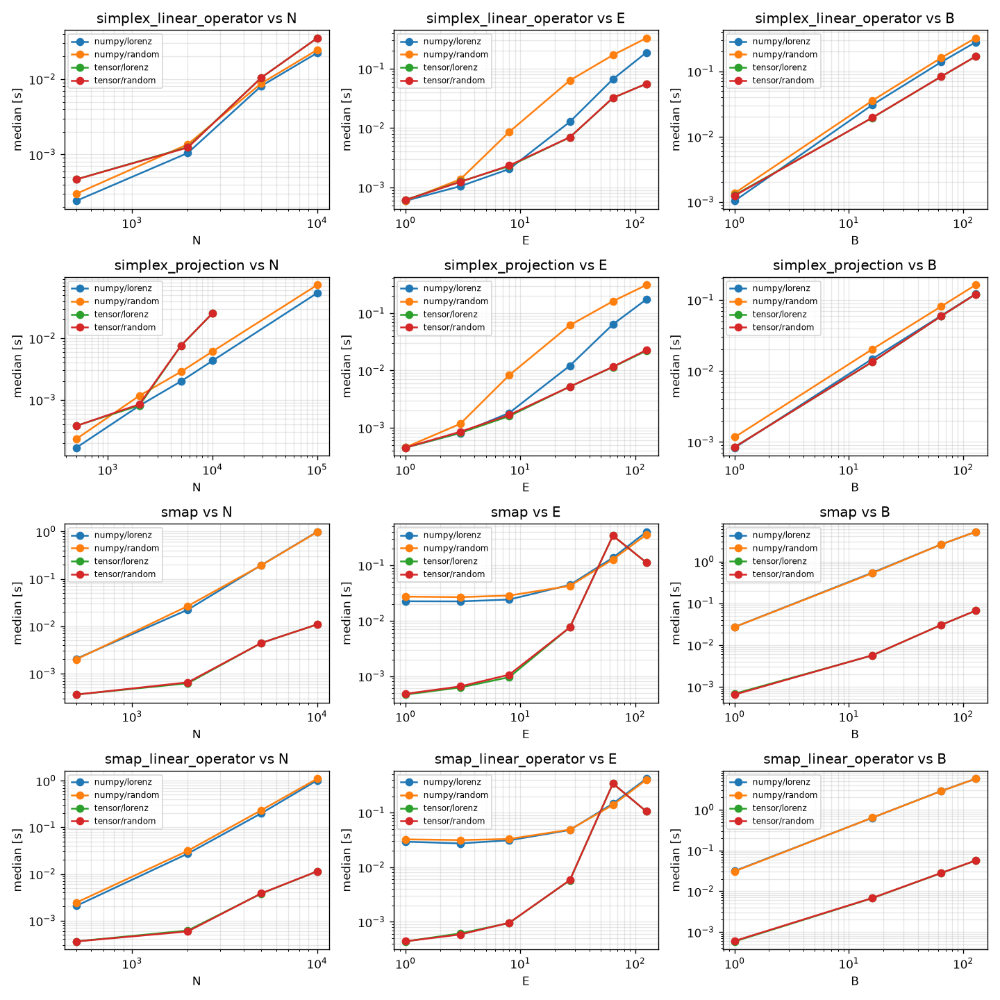
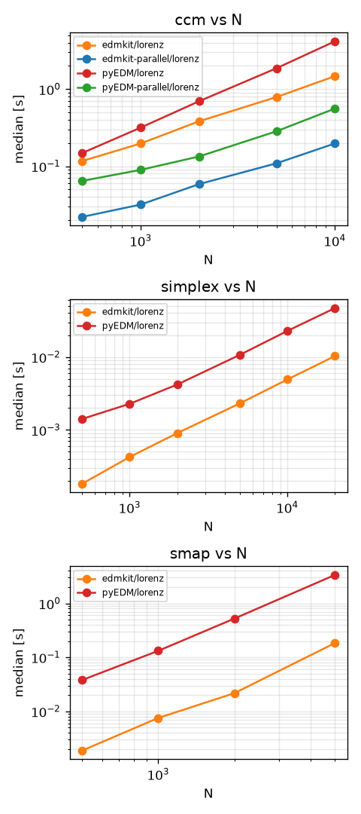

# edmkit

This library is a collection of tools and utilities that are useful for Empirical Data Modeling (EDM) and related tasks. The library is designed to be fast and lightweight, and easy to use.

[benchmarks](./benchmarks)



[compare.py](./benchmarks/compare.py)



| simplex N | edmkit [ms] | pyEDM [ms] | speedup |
|---:|---:|---:|---:|
| 500 | 0.2 | 1.4 | 8x |
| 1,000 | 0.4 | 2.3 | 5x |
| 2,000 | 0.9 | 4.2 | 5x |
| 5,000 | 2.3 | 10.7 | 5x |
| 10,000 | 4.9 | 22.8 | 5x |
| 20,000 | 10.3 | 46.8 | 5x |

| smap N | edmkit [ms] | pyEDM [ms] | speedup |
|---:|---:|---:|---:|
| 500 | 1.9 | 38.0 | 20x |
| 1,000 | 7.5 | 132.1 | 18x |
| 2,000 | 21.6 | 522.6 | 24x |
| 5,000 | 183.7 | 3,364 | 18x |

| ccm N | edmkit [ms] | pyEDM [ms] | speedup | edmkit parallel [ms] | pyEDM parallel [ms] | speedup |
|---:|---:|---:|---:|---:|---:|---:|
| 500 | 116.7 | 148.4 | 1.3x | 22.0 | 64.5 | 2.9x |
| 1,000 | 197.1 | 316.8 | 1.6x | 31.8 | 89.7 | 2.8x |
| 2,000 | 382.8 | 696.8 | 1.8x | 58.6 | 133.8 | 2.3x |
| 5,000 | 788.0 | 1,863 | 2.4x | 108.9 | 283.5 | 2.6x |
| 10,000 | 1,470 | 4,166 | 2.8x | 197.0 | 558.9 | 2.8x |


## Installation

To install the library, you can use pip:

```bash
pip install edmkit
```

Or you can also use [uv](https://docs.astral.sh/uv/):

```bash
uv add edmkit
```

## Testing

```bash
# Run all tests
uv run pytest

# Skip slow tests
uv run pytest -m "not slow"

# Run with CI profile (more hypothesis examples)
HYPOTHESIS_PROFILE=ci uv run pytest
```
