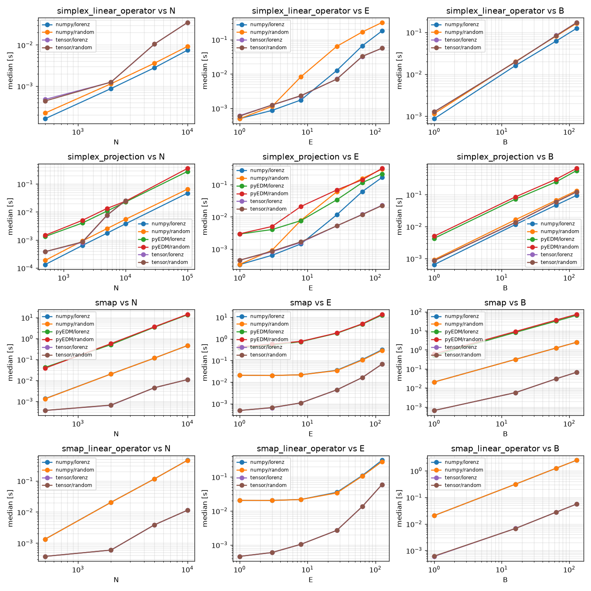
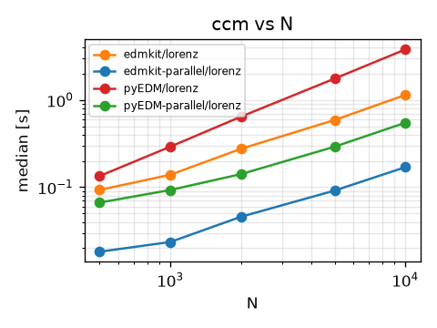

Measured on an Apple M4 Pro on November 5, 2026. Times are medians from `pytest-benchmark`.

## Simplex projection and S-map

[scripts](https://github.com/FujishigeTemma/edmkit/tree/main/benchmarks)

## CCM

[script](https://github.com/FujishigeTemma/edmkit/blob/main/benchmarks/compare.py)

Parallel CCM uses 14 workers.

| ccm N | edmkit [ms] | pyEDM [ms] | speedup | edmkit parallel [ms] | pyEDM parallel [ms] | speedup |
| ---: | ---: | ---: | ---: | ---: | ---: | ---: |
| 500 | 93.0 | 134.3 | 1.4× | 18.2 | 66.7 | 3.7× |
| 1,000 | 138.9 | 291.6 | 2.1× | 23.6 | 92.9 | 3.9× |
| 2,000 | 275.8 | 644.4 | 2.3× | 45.9 | 141.4 | 3.1× |
| 5,000 | 588.8 | 1,756.9 | 3.0× | 91.5 | 291.2 | 3.2× |
| 10,000 | 1,140.5 | 3,792.7 | 3.3× | 169.7 | 548.1 | 3.2× |

| ccm N | edmkit peak [MiB] | pyEDM peak [MiB] | edmkit parallel peak [MiB] | pyEDM parallel peak [MiB] |
| ---: | ---: | ---: | ---: | ---: |
| 500 | 171 | 170 | 191 | 1,417 |
| 1,000 | 173 | 176 | 196 | 1,429 |
| 2,000 | 179 | 186 | 207 | 1,460 |
| 5,000 | 204 | 224 | 239 | 1,624 |
| 10,000 | 230 | 362 | 297 | 1,804 |
